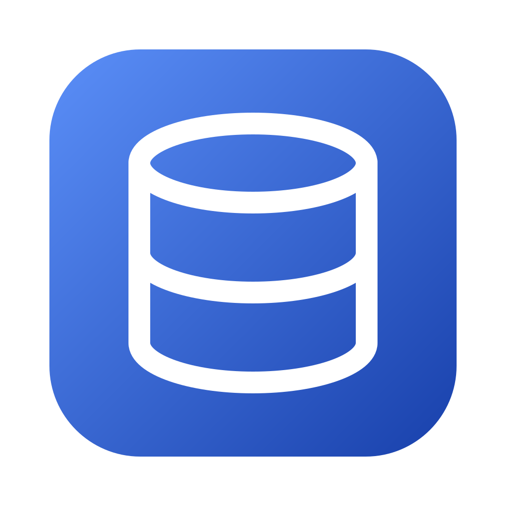
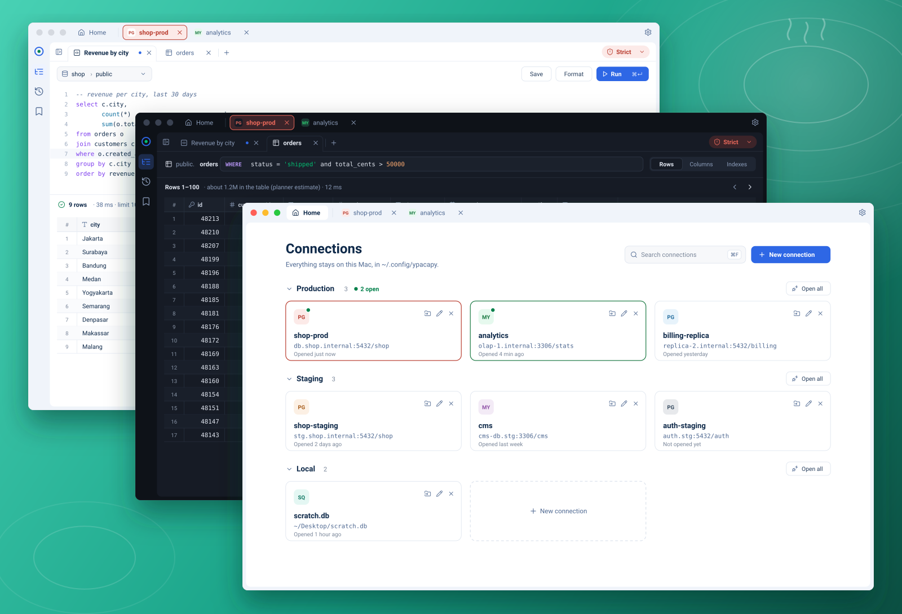

<div align="center">



# ypacapy

**A database client with the temperament of a capybara.**

Calm. Local. Unbothered. Sits in the hot spring with your databases and asks nothing of you.
PostgreSQL, MySQL/MariaDB, SQLite, MongoDB and Redis, on a small Rust core.

<sub><i>Read it backwards. Still ypacapy. Still a capybara.</i></sub>

[](https://github.com/jimmyfish/ypacapy/releases/latest)
[](https://github.com/jimmyfish/ypacapy/actions/workflows/release.yml)
[](https://github.com/jimmyfish/ypacapy/releases)

[](https://github.com/jimmyfish/ypacapy/releases/latest)
[](https://v2.tauri.app)
[](https://www.rust-lang.org)
[](https://react.dev)
[](#what-it-does)
[](#what-it-does)
[](#what-it-does)
[](#mongodb)
[](#redis)
[](#why-another-database-client)
[-never%20on%20its%20own-e67e22?style=flat-square)](#why-another-database-client)
[](#why-another-database-client)

[**Download**](https://github.com/jimmyfish/ypacapy/releases/latest) · [What it does](#what-it-does) · [ER diagrams](#er-diagrams) · [The write guard](#the-write-guard) · [Shortcuts](#shortcuts) · [Hack on it](#hack-on-it) · [Changelog](CHANGELOG.md)

<br />



</div>

---

##  Why another database client?

Because you opened a database client to look at *one* table and it counted every row of a 400-million-row table to draw the sidebar, while your DBA watched. Not cute.

ypacapy goes the other way:

-  **Tiny.** Uses the webview macOS already ships instead of bundling a browser. The heavy lifting is Rust (`sqlx`, `sqlparser`, `tokio`, the official MongoDB driver and `redis-rs`).
-  **Local. Like, actually local.** No account, no cloud sync, no telemetry. Settings and connections are TOML files in `~/.config/ypacapy`. Passwords live in the macOS Keychain.
-  **Quiet on your server.** ypacapy runs only catalog lookups and limited reads on its own. Row counts are planner estimates, never `count(*)`. Redis keys are read with `SCAN`, never `KEYS`. Nothing polls. Everything else is a query *you* typed.
-  **Hard to fat-finger.** A per-connection write guard asks before `DELETE`, `DROP`, `deleteMany`, `FLUSHDB` and friends: a confirm, or your passphrase or Touch ID on the connections that matter.
-  **A party of one.** No team plans, no shared workspaces, no presence avatars. Just you and a capybara in the onsen.

##  Get it

1. Grab the `.dmg` for your Mac (Apple Silicon or Intel) from the [latest release](https://github.com/jimmyfish/ypacapy/releases/latest).
2. Drag ypacapy into Applications.
3. The app is ad-hoc signed (no Apple Developer ID), so macOS will side-eye it on first launch. Calm it down once with:

   ```sh
   xattr -cr /Applications/ypacapy.app
   ```

After that, the app updates itself. A little chip shows up in the title strip when a new version lands.

##  What it does

###  Connections and the schema tree

- **PostgreSQL, MySQL/MariaDB and SQLite**, one async driver family (`sqlx`). Column types come from each driver's own result metadata.
- **MongoDB and Redis** too, each with its own sidebar, tabs and console. See [MongoDB](#mongodb) and [Redis](#redis) below.
- **Home** shows connections as coloured tiles, in named groups you can fold, rename or ungroup. `⌘F` finds one, `Enter` opens it.
- **Per connection:** SSL mode (`disable` through `verify-full`, with a CA file), connect timeout, PostgreSQL `application_name`, and its own row limit and statement timeout. Test checks it before you save.
- **Schema tree:** databases, schemas, tables, views, materialized views, foreign tables and functions. Each schema loads when you expand it and stays cached until Refresh. Pick the database and schema from the context picker.
- **Open tabs come back.** Each connection's tabs, including unsaved SQL, are restored the next time you open it. Pin a tab (right-click it) to keep it at the left of the row; pinned table tabs come back too, with their `WHERE` filter. Tabs take the connection's colour, so prod doesn't have to look like staging.

###  The SQL console

- `⌘↵` runs the selection, or with nothing selected the statement the cursor is in (up to the next `;`). `⇧⌘↵` runs the whole editor. Several statements in one run? Fine.
- **Autocomplete** for tables, aliases and columns. It reuses the schema tree you already loaded and reads a table's columns once, the first time a statement names it. Keystrokes never hit the database.
- **Format** (via `sql-formatter`) and `⌘/` to comment lines. Both stay on the native undo stack, so `⌘Z` behaves.
- **Row limit** (100 by default) is added to a query that has no `LIMIT` of its own. When it can't be added, ypacapy keeps at most 10,000 rows of a result set.
- **Cancel** and the statement timeout (30 s by default) stop the query on the server too (`pg_cancel_backend`, `KILL QUERY`), so nothing keeps grinding after you've given up on it.
- **Errors read like your database's own client**, with `LINE n:` and a caret under the spot. Lost the connection? It says so and offers Reconnect.
- `CREATE`, `ALTER` or `DROP` reloads the schema tree by itself.

###  Results, tables and editing

- **Result grid:** sort, frozen primary-key columns, typed cells (numbers, timestamps, booleans, coloured JSON, bytes), a cell inspector, and `⌘C`.
- **Export** rows as CSV, JSON, Markdown table or plain text.
- **Edit in place.** A result that reads one table plainly (no join, group, union or distinct), with its full primary key, can be edited. Type over a cell, `⌘⌫` a row, then `⌘S`. All changes go in one transaction, one `UPDATE` or `DELETE` per row keyed by the primary key. If any statement touches more or fewer than one row, the whole thing rolls back.
- **Table tabs:** rows with a `WHERE` filter and paging, plus the table's columns, indexes and foreign keys from the catalog.

###  MongoDB

- **Connect** with a host and port, a seed list, an SRV record (`mongodb+srv`), or by pasting a `mongodb://` URL. Auth database, TLS (CA file, or a client certificate for X.509), replica set, read preference and direct connection are all there.
- **Collections open on a query bar:** Filter, Project and Sort take mongosh values (`ObjectId()`, `ISODate()`, `/regex/`, unquoted keys), with Skip and Limit beside Run. Each box is checked before anything is sent, so a typo never reaches the server, and no sort is added you didn't ask for.
- **Documents as a table or as JSON.** One column per top-level field, typed by BSON, with how many documents have each field; a missing field is hatched, not shown as null. Copy and export as mongosh, Extended JSON, CSV or Markdown.
- **Fields, Indexes and Info.** Fields lists the paths seen on the page (ypacapy never samples the collection). Info reads `$collStats` once when it opens: the server's document count, sizes, compression and each index's size.
- **mongosh console:** `find`, `aggregate`, `countDocuments`, `distinct`, the write methods, `createIndex`, `runCommand` and `.explain()`. The text is parsed, never run as JavaScript. A find or aggregate without a limit gets the row limit, and `maxTimeMS` stops a slow one on the server.

###  Redis

- **Connect** with host, port, user (ACL) and database number, or paste a `redis://` or `rediss://` URL. TLS with a CA file or a client certificate.
- **Keys in the sidebar,** read with `SCAN` about 1,000 at a time, in folders on the key separator (`:` by default, per connection), with a type badge and a timer on keys that expire. Enter in the filter scans for matching keys.
- **Key tabs** open on the key's type, length and TTL over one page of its value: hash fields (`HSCAN`), list items, set members, sorted-set members by score, a stream's newest entries, or a string as text or pretty JSON.
- **redis-cli console:** one command per line, quoted as redis-cli quotes. Replies show as a table or as redis-cli prints them. A `WRONGTYPE` error offers the command that reads the key's real type.

###  ER diagrams

- **Show diagram** on a schema, or on a table for that table and the tables it links to. PostgreSQL, MySQL/MariaDB and SQLite.
- **You pick the tables.** A picker lists the schema's tables, with a filter, Select all, Unselect all and Add linked tables. Only the ticked tables are read, and only from the catalog: columns, keys and unique indexes, never a row. Views are left out, since they have no foreign keys.
- **Tables from other schemas** that a picked table links to are drawn too, with a dashed border (PostgreSQL in both directions; MySQL for the tables a picked table references).
- **Drag tables, pan, zoom.** Select a table to see the columns its keys link and the cardinality at each end (`1`, `*`, `0..1`). Double-click opens its rows. Switch between all columns, key columns or table names only.
- **Save keeps the layout.** Save (`⌘S`) stores the picked tables, where each one sits, the zoom and the column choice with the connection, so Show diagram brings it back as saved, after a restart too. Nothing is saved on its own: the toolbar says *Not saved* until you save, and closing asks first. Tables ticked later are placed to the right of the saved ones; a table altered since keeps its place.
- **Export** as a PNG (with or without the background) or JPG image, Mermaid `erDiagram` code, DBML for dbdiagram.io, or a diagrams.net `.drawio` file. Everything is written on your Mac; ypacapy never opens or sends anything to those sites.

###  History and saved queries

- **History** belongs to the open connection: its last 2,000 runs, searchable, with time, rows and status. Clear empties only that connection's list.
- **Saved queries** live in folders. A tab tied to a saved query shows when it has drifted from the saved text.

###  Make it yours

- **Light or dark**, each with its own colour scheme: ypacapy Light / Dark, plus the Ayu, Atom One and Xcode families.
- **Fonts:** pick the UI, table and code fonts from what's installed on your Mac, each with its own size.
- **Compact mode** for small screens and big result sets.
- **Connection heartbeat** (off by default): a `select 1` on idle PostgreSQL and MySQL connections every 30 s, for servers or VPNs that drop idle sessions. Each connection can override it.

##  The write guard

Every connection has a **security level**. Set it in the connection's Options or straight from the tabs bar.

| Level | Before a protected statement |
| --- | --- |
| **None** | It runs. Your local SQLite scratchpad doesn't need a bouncer. |
| **Low** | ypacapy asks you to confirm. |
| **Strict** | ypacapy asks for the app passphrase, or Touch ID if the connection allows it. |

**What to protect** picks the statement kinds a level cares about: `INSERT`, `UPDATE`, `DELETE`, `REPLACE` (MySQL), `ALTER`, `DROP`, `TRUNCATE`, `CREATE`, `GRANT`, `REVOKE`. `SELECT` never asks.

- **MongoDB:** kinds of write method (insert, update, delete, findAndModify, `$out` and `$merge` in an aggregate, drop, create, rename, users). The ask shows the method that will run. A `runCommand` ypacapy doesn't know asks too.
- **Redis:** commands grouped by what they write to (strings, hashes, lists, sets, sorted sets, streams, keys, expiry, flush, scripts, server), plus `KEYS`, which holds the server while it reads every key; its ask offers Use SCAN instead. A command ypacapy doesn't know asks too.
- When what runs deletes or overwrites data, the ask says it cannot be undone, in red, with the shredder on the button.

<details>
<summary> <b>How it decides, and why it's hard to sneak past</b></summary>

<br />

- Statements are classified from the parsed SQL (`sqlparser`), never a regex. That includes statements hiding in CTEs and `EXPLAIN ANALYZE`, and every statement of a multi-statement run.
- If the dialect can't parse the text, the tokenizer splits it at top-level semicolons and the leading keywords decide. Text that can't even be tokenized counts as unreadable, so ypacapy asks.
- A Strict connection can stay unlocked for a window you choose after the passphrase. Unlocking one connection never unlocks another.
- **Lowering** a Strict connection (a lower level, fewer protected statements, allowing Touch ID, a longer window) needs the passphrase too.
- Strict needs a passphrase, set in Settings › Security. Disable the passphrase and Strict connections drop to Low, so they still ask about the same statements.
- **Forgot the passphrase?** The Mac's owner (Touch ID or the login password) can set a new one. The old one can't be shown: the Keychain holds only a salted PBKDF2 hash.

</details>

##  Shortcuts

Hands off the mouse.

| Key | What happens |
| --- | --- |
| `⌘T` | New query tab |
| `⌘W` | Close the tab |
| `⇧⌘W` | Close the window |
| `⌘↵` | Run the selection, or the statement at the cursor (in a table tab: re-read the rows) |
| `⇧⌘↵` | Run the whole editor |
| `⌘S` | Save the query, write the grid's pending edits, or save a diagram's layout |
| `⌘/` | Comment or uncomment the selected lines |
| `⌘\` | Show or hide the sidebar |
| `⌘F` | Find a connection on Home |
| `⌘,` | Settings |
| `⌘C` | Copy the selected cell |
| `↵` / `F2` | Edit the selected cell (or just start typing) |
| `⌘⌫` | Delete or restore the selected row |
| `⌘` + arrow | Jump to the edge of the grid |
| `+` / `-` / `0` | Zoom a diagram in, out, or to actual size |

##  Where's my data?

On your Mac, in one folder you can find, back up and delete:

- **`~/.config/ypacapy/`** (on macOS too, not Application Support), created with mode `0700`:
  - `settings.toml`: your settings
  - `connections.toml`: every connection, minus the passwords
  - `ypacapy.db`: history, saved queries, and each connection's open tabs and saved diagrams (SQLite)
- **The macOS login Keychain**, service `ypacapy`: connection passwords and the passphrase hash. Items are marked not synchronizable, so iCloud Keychain never copies them off the Mac. Nothing secret is ever written to a file.

Files are written through a temp file and a rename, so a crash never leaves half a file. Settings › Data on this Mac › Show in Finder takes you there.

##  Hack on it

You'll need macOS, [Rust](https://rustup.rs), [Bun](https://bun.sh) and the Xcode Command Line Tools.

```sh
bun install
bun tauri dev        # run the app with hot reload (Vite on http://localhost:1420)
bun tauri build      # build the release bundle (.app / .dmg)
bun run typecheck    # TypeScript check only
```

- Dev builds (`bun tauri dev`, `bun tauri build --debug`) never check for updates, so the GitHub release never replaces them. About shows their commit, branch and tag instead.
- New icon? `bunx tauri icon app-icon.svg` regenerates the lot. Then `touch src-tauri/src/lib.rs` so `tauri dev` embeds it again.
- The window stack at the top is drawn, not screenshotted. `node docs/assets/build-window.mjs` redraws `docs/assets/ypacapy-window.svg` with fresh dummy data.
- Tests that need the outside world are `#[ignore]`d. Inside `src-tauri`, `cargo test` runs the unit tests and `cargo test -- --ignored` adds the Keychain test, the PostgreSQL tests (a local server on `localhost:5432` that lets `$USER` in; they only select and use session temp tables), and the MongoDB and Redis tests (`YPACAPY_TEST_MONGO=localhost:27017`, `YPACAPY_TEST_REDIS=localhost:6379` by default).
- Agents (and the humans steering them) start at [AGENTS.md](AGENTS.md), which explains the graphify knowledge graph in `graphify-out/`.

<details>
<summary> <b>Where things live</b></summary>

<br />

```
src-tauri/src/db.rs        SQL connection pools, catalog reads, run_query, cancel, apply_edits, heartbeat
src-tauri/src/db/erd.rs    ER diagrams: the picked tables' columns, keys and links, from the catalog
src-tauri/src/db/mongo.rs  MongoDB: client, collection tab, console runs, $collStats Info
src-tauri/src/db/redis.rs  Redis: SCAN tree, key tabs, console runs, key Info
src-tauri/src/mongo_shell.rs  mongosh text parsed into driver calls (never run as JavaScript)
src-tauri/src/redis_cli.rs    redis-cli line splitting and command kinds for the guard
src-tauri/src/guard.rs     write guard: statement classification, security levels, passphrase, Touch ID
src-tauri/src/conns.rs     connections.toml, security level changes, groups
src-tauri/src/store.rs     ypacapy.db: history, saved queries, open tabs, saved diagrams
src-tauri/src/keychain.rs  connection passwords and the passphrase hash in the macOS Keychain
src-tauri/src/settings.rs  settings.toml, and the parts Rust enforces (row limit, timeout, heartbeat)
src-tauri/src/fonts.rs     installed system fonts for Settings
src-tauri/src/paths.rs     ~/.config/ypacapy, atomic writes, export files (text and images)
src/store.ts               app state (zustand)
src/types.ts               shared types, mirrored by the Rust structs
src/lib/                   SQL, mongosh and redis-cli helpers, autocomplete, grid edits, cell formats,
                           BSON, ER diagram layout and exports, themes, updater
src/components/            UI: Home, Sidebar, QueryPane, SqlEditor, ResultGrid, TablePane,
                           CollectionPane, KeyPane, DiagramPane, Modals, ...
.github/workflows/         release and Rust cache pipelines
```

</details>

<details>
<summary> <b>Cutting a release</b></summary>

<br />

1. Bump the version in `package.json`, `src-tauri/Cargo.toml` and `src-tauri/tauri.conf.json`.
2. Move the `[Unreleased]` notes in [CHANGELOG.md](CHANGELOG.md) into a `## [x.y.z] - YYYY-MM-DD` section. Write bullets as `- **Lead.** detail`: the app shows each bold lead as one line of the release notes.
3. Commit, then tag and push: `git tag vx.y.z && git push origin vx.y.z`.
4. `.github/workflows/release.yml` creates a draft release with that CHANGELOG section as its notes, builds `aarch64-apple-darwin` and `x86_64-apple-darwin`, and uploads the bundles and `latest.json`.
5. Publish the draft by hand. Until then, installed copies keep seeing the previous release.

Fix release notes in CHANGELOG.md before tagging. Edits on the draft reach the release page but not `latest.json`, which is what the app reads.

The workflow needs two repository secrets: `TAURI_SIGNING_PRIVATE_KEY` (the contents of `~/.tauri/ypacapy.key`) and `TAURI_SIGNING_PRIVATE_KEY_PASSWORD`. `.github/workflows/cache.yml` keeps a Rust dependency cache on `master` for release runs to restore.

</details>

##  Never on the wishlist

ypacapy is local by design. Like a capybara in a hot spring, it isn't going anywhere. It will never have:

- accounts, sign-in, or "invite your team"
- cloud sync, shared workspaces, or a "share link" for your connections
- telemetry, analytics, or "help us improve ypacapy" pings
- background queries that scan your tables to make a dashboard look busy

Your connection details, passwords and half-written `DELETE`s never leave your Mac.

##  Come soak with us

Bug reports, ideas and pull requests are welcome. Every version's changes are in [CHANGELOG.md](CHANGELOG.md).

<div align="center">
<br />
<sub>Made with coffee, Rust, and a capybara that refuses to be rushed.</sub>
</div>
